# TP1-DAR2026 – Sockets TCP en mode connecté

**Hana Ben Hmad** – LSI3 – Développement d'applications réparties

# Activité 1-1 : Première connexion Client/Serveur

## Étape 1 : Vérification de Git
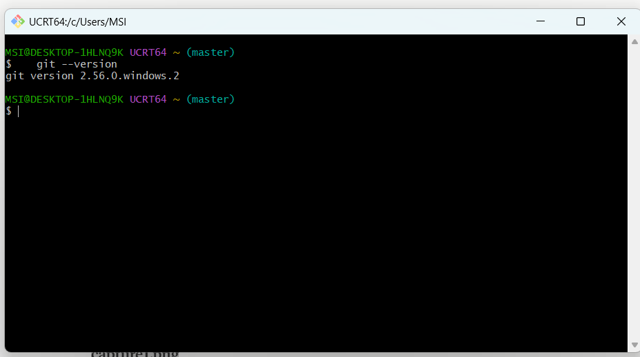

Git est installé : la commande `git --version` affiche la version installée
(git version 2.56.0.windows.2).

## Étape 2 : Vérification de Java
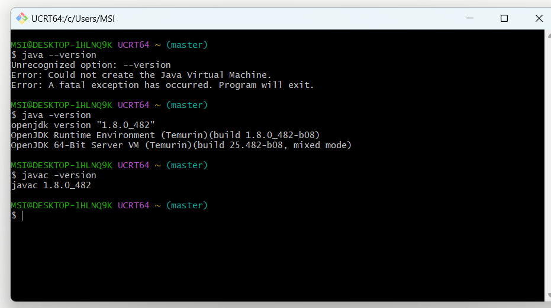

La commande `java --version` échoue (« Unrecognized option: --version ») car cette
option n'existe qu'à partir de Java 9. Avec le JDK 8 (Temurin 1.8.0_482), la commande
`java -version` affiche bien la version, et `javac -version` confirme la présence
du compilateur. Le projet est exécuté dans IntelliJ avec le JDK 25.

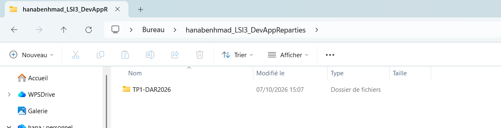

Création du répertoire de travail `hanabenhmad_LSI3_DevAppReparties` sur le Bureau.
Il contient le projet `TP1-DAR2026`.

## Étape 3 : Création du serveur
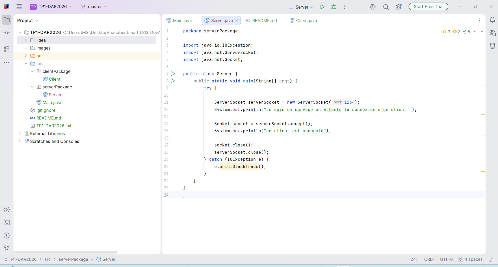

Création du projet `TP1-DAR2026` avec dépôt Git, du package `serverPackage`
et de la classe `Server` (`ServerSocket` sur le port 1234, `accept()`, fermeture des sockets).

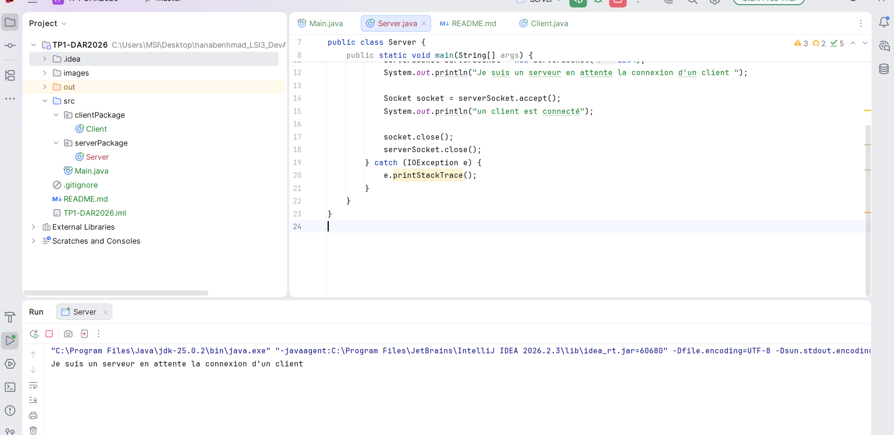

**Interprétation** : le `ServerSocket` s'ouvre sur le port 1234, puis `accept()`
est une méthode bloquante : le serveur attend sans rien faire qu'un client se
connecte. Le message « un client est connecté » n'apparaît pas encore, ce qui
prouve qu'aucun client n'est connecté.

## Étape 4 : Création du client
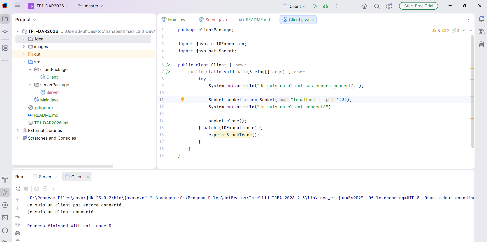

Client lancé avec `localhost` et le port 1234.

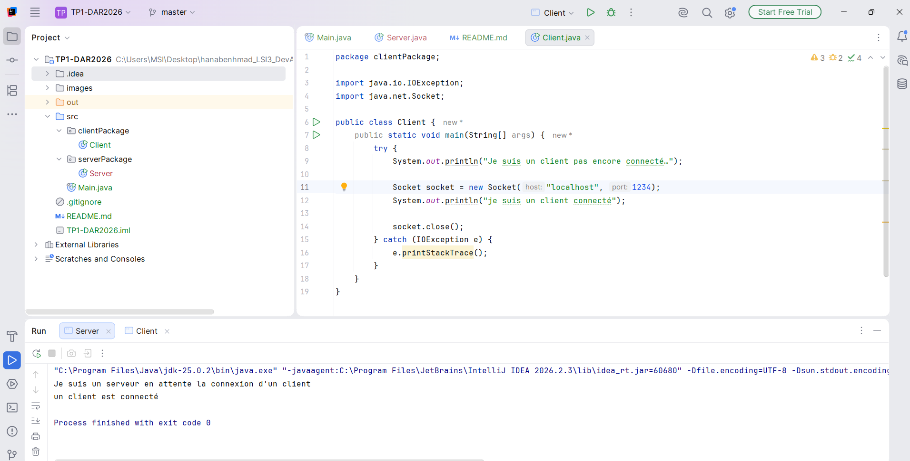

**Interprétation** : le client crée un `Socket` vers `localhost:1234`. Le serveur
débloque son `accept()` et affiche « un client est connecté ». Le client affiche
« je suis un client connecté » : la connexion TCP est établie. Les deux programmes
se terminent après la fermeture des sockets (`Process finished with exit code 0`).

### Avec une adresse IP (127.0.0.1)
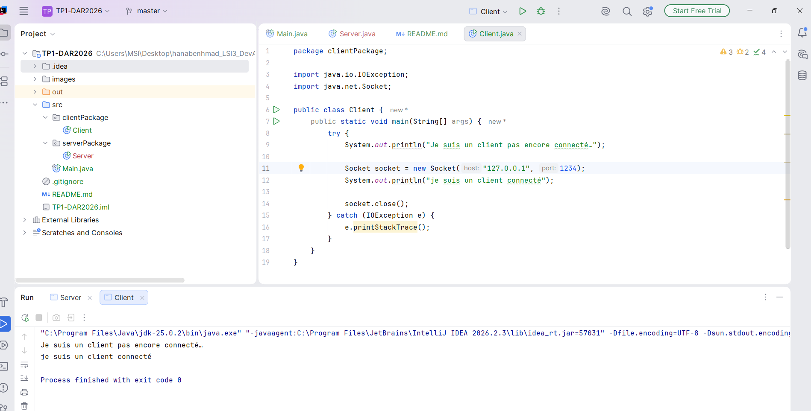

`127.0.0.1` est l'adresse de bouclage, équivalente à `localhost` : le résultat
est identique, la connexion est établie.

---

# Activité 1-2 : Service de calculatrice

## Étape 1 : Préparation de l'espace de travail
Le projet `TP1-DAR2026` de l'Activité 1-1 est réutilisé et étendu : le client envoie
un entier au serveur, qui le multiplie par 5 et renvoie le résultat.
Les échanges utilisent `DataInputStream` et `DataOutputStream`.

## Étape 2 : Service de multiplication

### Code du serveur
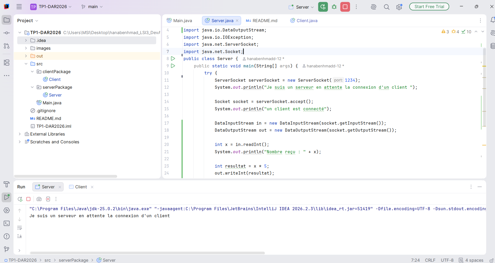

Le serveur attend un client, lit un entier avec `readInt()`, calcule `x * 5`,
puis renvoie le résultat avec `writeInt()`.

### Code du client
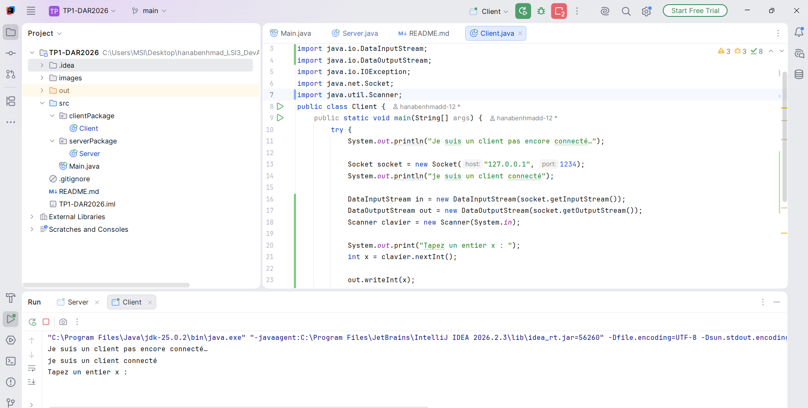

Le client lit un entier au clavier (`Scanner`), l'envoie avec `writeInt()`,
puis reçoit et affiche le résultat avec `readInt()`.

### Tests avec différentes valeurs
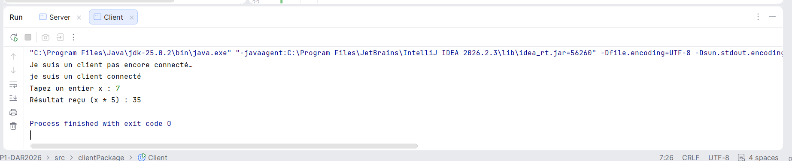

**x = 7** : le client reçoit 35 (7 × 5).

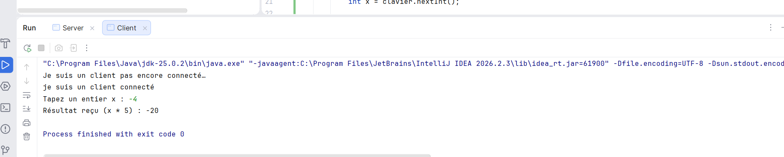

**x = -4** : le client reçoit -20. Les entiers négatifs sont bien transmis grâce à
`DataInputStream` / `DataOutputStream`, qui envoient l'entier sur 4 octets.

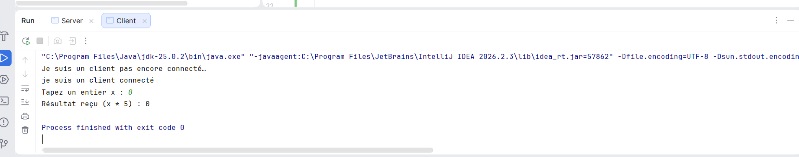

**x = 0** : le client reçoit 0 (0 × 5 = 0).

### Version finale avec boucle
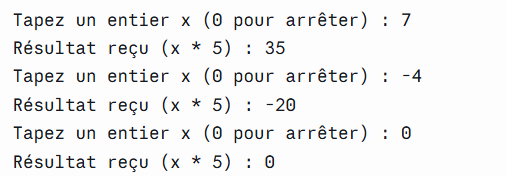

Le client saisit plusieurs entiers successivement. Après chaque saisie, il envoie
l'entier, reçoit le résultat (x * 5) et l'affiche. Quand l'utilisateur saisit **0**,
la boucle s'arrête, le serveur répond 0 puis les deux côtés ferment leurs sockets
proprement (`Process finished with exit code 0`).